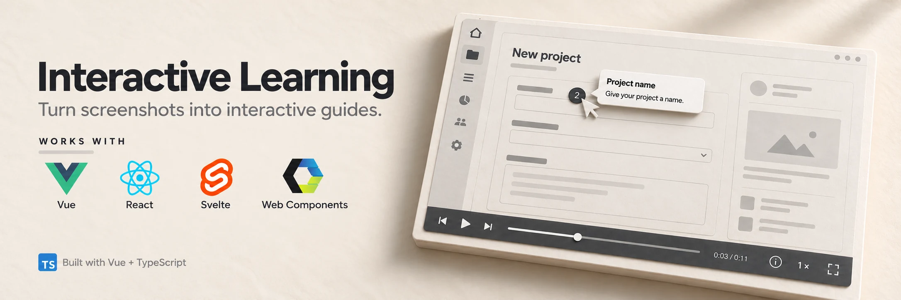
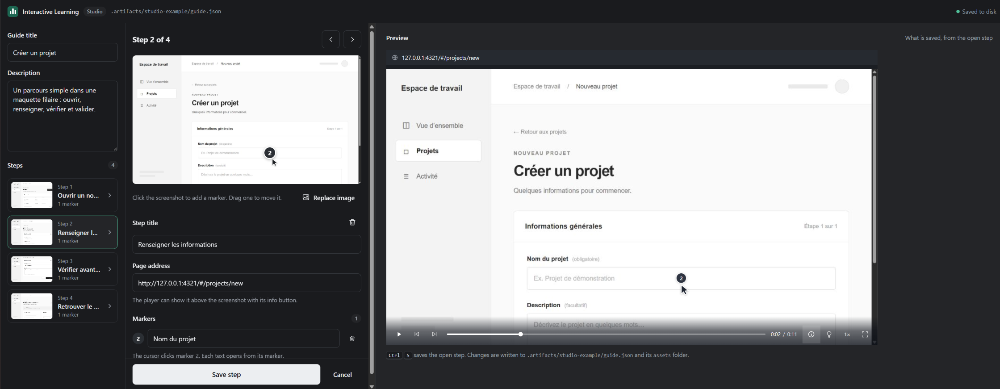

# Interactive Learning

Turn real screenshots into **interactive step-by-step guides**. Viewers play a guide like a short video, with an animated cursor and numbered markers, through one Web Component that works in **Vue, React, Svelte and plain HTML**.

## Interactive Learning Studio

Interactive Learning Studio is the desktop app for people who make tutorials without writing code, on Windows and Linux. It keeps the tutorials in a library on disk, one folder per site with its themes inside, and edits each tutorial like a short video.

- **Record** opens the site in the built-in browser, and each click becomes a step with its screenshot, the cursor and a numbered marker.
- On the timeline you order the steps and set how long each one plays, and on the canvas you place the markers.
- **Play** shows the tutorial in the player, **Publish** copies it into the web project of the site, and **Export** writes a ZIP.

Download it from the [releases](https://github.com/djdevpro/interactive-learning/releases). [Desktop app README](apps/desktop/README.md)

## Record a guide

**With the browser extension.** Click its icon to open the side panel, name the guide and walk through your flow. Every click, page and filled form becomes a step with its screenshot, and **Capture step** keeps a form before you submit it. Open any step to place as many numbered markers as you need. The export is a ZIP with `guide.json` and its screenshots, and **Import** opens such a ZIP again, including one written by an AI agent. Load the extension in Chrome from `chrome://extensions` with **Load unpacked**, using the folder that `npx -y @interactive-learning/recorder extension path` prints. [Limits and permissions](apps/extension/README.md)

**With an AI agent.** Install the skill once, then ask the agent to document a flow of your site. It drives its browser and writes the guide into the public folder of the project.

```sh
npx -y @interactive-learning/recorder skill install --agent claude
npx -y @interactive-learning/recorder skill install --agent codex
```

**From the command line.** `create`, `capture add`, `annotate` and `validate` build a guide from screenshot files. Run them with npx or add `@interactive-learning/recorder` as a dev dependency. [Recorder README](packages/recorder/README.md)

## Refine a guide in the web studio



A first recording rarely says everything. The web studio opens a guide of your project in the browser so you can finish it by hand, whoever recorded it.

- **A guide written by your AI agent** already sits in the public folder of the project. Open it as is.
- **A guide recorded with the extension** comes as a ZIP. Unzip it in the public folder, for example in `public/guides/sign-up/`, then open it.

```sh
npx -y @interactive-learning/recorder studio --guide public/guides/sign-up/guide.json
```

Click a screenshot to add markers, drag or delete them and write their texts. Fix step titles and page addresses, replace a screenshot or delete a step, and check the result in the preview. Each save writes `guide.json` and its images in place, so there is nothing to export afterwards. If the agent changes the guide while the studio is open, the studio does not overwrite it and offers to reload it.

## Play a guide

```sh
npm install @interactive-learning/player
# or
pnpm add @interactive-learning/player
```

```html
<interactive-learning src="/guides/sign-up/guide.json"></interactive-learning>
<script type="module">
  import '@interactive-learning/player/auto';
</script>
```

Screenshots load from the folder of `guide.json`. The [player README](packages/player/README.md) covers frameworks, themes, languages and styling.

Both packages are on npm, [`@interactive-learning/player`](https://www.npmjs.com/package/@interactive-learning/player) and [`@interactive-learning/recorder`](https://www.npmjs.com/package/@interactive-learning/recorder).

## Develop

Node.js 22.18 or later and pnpm 9.10.0.

```sh
pnpm install
pnpm build
pnpm dev:player
```

`pnpm dev:player` opens a live preview of the player on port 4316. `pnpm dev:all` starts the Vue, React, Svelte and HTML examples on ports 4317 to 4320, `pnpm dev:wireframe` a prototype to record on port 4321, `pnpm dev:studio` the web studio on a copy of the example guide, and `pnpm dev:desktop` Interactive Learning Studio, which needs Rust. `pnpm check` runs the types, tests and builds. `pnpm release:desktop` builds Interactive Learning Studio for Windows and Linux on GitHub and publishes the installers as a release, once its version in `apps/desktop/src-tauri/tauri.conf.json` is new.

| Folder              | Content                                                      |
| ------------------- | ------------------------------------------------------------ |
| `packages/player`   | Web Component player built with Lit                          |
| `packages/recorder` | Command line tool and API, with the extension and skill      |
| `packages/editor`   | Private step editor shared by the extension and the studio   |
| `packages/protocol` | Private guide format and validation, bundled into the others |
| `apps/extension`    | Browser extension                                            |
| `apps/studio`       | Web studio, served by the `studio` command                   |
| `apps/desktop`      | Interactive Learning Studio, the desktop app                 |
| `apps/example*`     | Example applications                                         |
| `skills`            | AI skill                                                     |

## License

MIT
