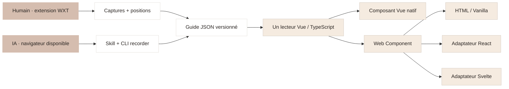

# Architecture Interactive Learning

Vue et TypeScript, pnpm et Node. Le nom anglais est **Interactive Learning**. Le lecteur est écrit une seule fois et distribué pour Vue, React, Svelte et HTML/Vanilla. Le scope npm reste à confirmer avant publication.

## Trois packages publiables

| Package                          | Rôle                                                                           | Installation                                 |
| -------------------------------- | ------------------------------------------------------------------------------ | -------------------------------------------- |
| `@interactive-learning/recorder` | API TypeScript, CLI, skill IA et extension Chrome compilée                     | Dépendance de développement                  |
| `@interactive-learning/vue`      | Composant `InteractiveGuide`, moteur `TimelineController`, types et validation | Dépendance publique ; Vue en peer dependency |
| `@interactive-learning/player`   | Web Component, adaptateurs `/react` et `/svelte`, types et validation          | Dépendance publique ; Vue et CSS embarqués   |

Le module `packages/protocol` est privé. Ses types et son code utile sont intégrés aux distributions ; il n’ajoute pas de package à installer. `apps/extension` contient les sources WXT Vue. Les adaptateurs React et Svelte raccordent propriétés, événements et commandes au Web Component ; ils ne recopient ni l’interface ni le moteur.

**Aucun Studio ni éditeur visuel.** La création et la maintenance passent par la programmation, l’extension ou l’IA, conformément au choix de l’utilisateur.

## Contrat et capture

`schemaVersion: "1.0.0"` est indépendant des versions npm. Le document contient des assets identifiés et des étapes stables : titre, explication, durée, image, pointeur normalisé `[0,1]`, annotations et contexte de capture facultatif. Images PNG/JPEG/WebP, intégrées en data URI ou servies via des chemins relatifs. Validation réelle à l’import ; une version inconnue est refusée. Les migrations viendront avec le premier changement de schéma.

L’extension observe les actions, capture le viewport natif et conserve les images dans IndexedDB. Elle séquence les captures à 600 ms minimum. Un clic est associé à une image précédente uniquement si document, URL, révision DOM, taille, scroll et DPR concordent. Sinon le pointeur est omis avec un diagnostic. Les images prises pendant un changement de contexte sont rejetées. Un bouton de capture explicite conserve le formulaire rempli avant son envoi.

Ce prototype ne garantit pas la capture automatique avant une soumission, n’instrumente pas les iframes et met en pause les changements d’origine. Aucun test métier ni moteur de rejeu n’est embarqué. L’IA utilise son navigateur existant ; le CLI importe ses fichiers image. Pas de dépendance Playwright et pas de serveur MCP requis.

## Programmation et lecture

`RecordingSession` gère création, ajouts, remplacement et annotations. `GuideExporter` copie ou intègre les images. Les écritures de guides sont verrouillées et atomiques. Remplacer une image conserve l’ID de l’étape, son texte et ses annotations ; le pointeur est retiré et les repères doivent être vérifiés.

`TimelineController` est indépendant de Vue. Le composant anime l’image, le pointeur et les annotations, avec Play/pause, progression, retour arrière et navigation au clavier. Plusieurs instances sont indépendantes. L’interface reste limitée au lecteur et à ses commandes en surimpression ; les explications sont masquées par défaut, affichables avec « i ».

L’intégration Vue importe explicitement le CSS. Le lecteur universel embarque le même CSS dans son Shadow DOM, qui l’isole des styles de l’application hôte. Son import est compatible SSR, mais son contenu est monté côté navigateur : le rendu serveur fournit seulement son emplacement. Voir les [choix et limites multi-frameworks](multi-framework.md).

## Quatre applications indépendantes

| Dossier               | Intégration    | Commande          | Port |
| --------------------- | -------------- | ----------------- | ---- |
| `apps/example`        | Vue native     | `pnpm dev:vue`    | 4317 |
| `apps/example-react`  | React          | `pnpm dev:react`  | 4318 |
| `apps/example-svelte` | Svelte         | `pnpm dev:svelte` | 4319 |
| `apps/example-html`   | HTML / Vanilla | `pnpm dev:html`   | 4320 |

Après `pnpm build`, `pnpm dev:all` lance les quatre lecteurs. Chacun consomme le SDK et le même guide public : captures et annotations d’un prototype HTML wireframe. Vue charge toujours ce guide par défaut ; `?sample=1` le sélectionne explicitement.

`apps/wireframe` est une application supplémentaire, indépendante des lecteurs : le prototype HTML navigable à photographier. `pnpm dev:wireframe` le lance sur le port **4321**. Il n’est pas inclus dans `dev:all`. Les captures sources du guide partagé sont conservées dans `examples/wireframe/captures` ; `pnpm example:assemble` les assemble sans rejouer le navigateur.

Les cours métier locaux sont chargés par Vue seulement avec un paramètre `?cours=…` explicite. Ces captures et cours sont exclus de Git et des distributions npm. Le dépôt public fonctionne sans eux. Toutes les applications sont privées au sens npm et ne sont pas publiées comme packages.

## Distribution

Vite construit les bibliothèques et applications, WXT construit l’extension et tsdown construit le recorder. L’outil officiel `@sveltejs/package` prépare l’adaptateur Svelte. Le build racine copie l’extension et le skill dans le recorder.

Changesets synchronise les versions de Vue et player, tandis que recorder évolue indépendamment. Le workflow GitHub contrôle formatage, types, builds et archives, sans lancer les tests automatisés. `pnpm run deploy` demande une PR de versions ; la publication npm est une action séparée. Le dépôt cible est [`djdevpro/interactive-learning`](https://github.com/djdevpro/interactive-learning). La publication npm exige encore un compte propriétaire du scope et la configuration du publisher. Voir [les publications](releases.md).
